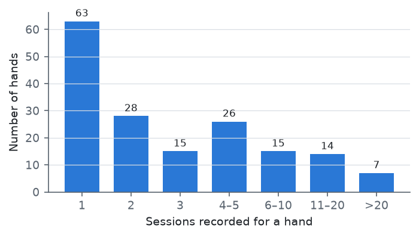

# Data

All three datasets are converted to the same canonical form before training:
MediaPipe finds 21 hand landmarks, the image is rotated so that the fingers point up,
cropped to a square around the hand and **left hands are mirrored** to look like right
hands. Left and right hand of one person are still treated as *different* identities.

No example images are included in this repository to protect participants' privacy.

## Overview

| Dataset | Images | People | Hands (identities) | Hands with ≥2 sessions | Hand detected (MediaPipe) | Split |
|---|---|---|---|---|---|---|
| ours | 3661 | 87 | 168 | 105 | 98.9 % | 10 people-disjoint folds |
| 11k | 5680 | 190 | 379 | – (1 session) | 96.4 % | train 152 / test 38 people |
| hd | 5992 | 714 | 714 | – (1 session) | 77.2 % | train 571 / test 143 people |

* **ours** – our dataset (`kfolds_people`), dorsal side, phone photos, varied backgrounds.
  Participants are anonymised (`ours_000` …); the name map is kept outside the repository.
* **11k** – 11k Hands (Afifi, 2019), only the *dorsal* images, white background, 1 session.
* **hd** – PolyU Contactless Hand Dorsal (Kumar & Xu, 2016), right hands, 1 session.
  External datasets are split by person; 20 % of people are a fixed test set never used for training.

## Our dataset in detail

* **Duplicates.** 67 images were byte-identical copies of images in *another session of the
  same hand* (48 originals). They were removed; otherwise "cross-session" comparisons
  would include identical images and look better than reality.
* **Sessions are very unevenly distributed.** Median 2 session(s) per person,
  maximum 79. The most recorded hand has 304 images, the median hand 8.
  Evaluation therefore weights every hand equally (see Task 1 report).

### Label audit

Two independent checks of the session labels (`scripts/audit_sessions.py`):

* **Model-based.** Every session is compared with the other sessions of the same hand by a model
  that never saw that person (`ours_only`, held-out fold). 301 of
  853 sessions do not reach the 1 %-FAR threshold against their own hand,
  152 are closer to the person's other hand and 179 to another
  person. At ~14 % cross-session EER this mostly measures the model, not label errors.
* **Geometric.** After canonicalisation every hand must look like a right hand (thumb left of the
  little finger, MediaPipe). 97.8 % of images pass, 0.6 % fail,
  1.5 % undetected. **4 sessions (4 people) were stored under the wrong
  hand**; they are corrected in `configs/label_fixes.yaml` and all results use the corrected labels.
  Only 1 of the model's "other hand is closer" flags was a real swap.

### Folds

| Fold | People | Hands | Images | Sessions |
|---|---|---|---|---|
| fold_0 | 9 | 18 | 933 | 234 |
| fold_1 | 9 | 17 | 276 | 68 |
| fold_2 | 9 | 18 | 268 | 67 |
| fold_3 | 9 | 17 | 464 | 115 |
| fold_4 | 9 | 18 | 140 | 35 |
| fold_5 | 9 | 18 | 216 | 54 |
| fold_6 | 9 | 16 | 368 | 92 |
| fold_7 | 8 | 15 | 196 | 49 |
| fold_8 | 8 | 16 | 512 | 128 |
| fold_9 | 8 | 15 | 288 | 72 |
