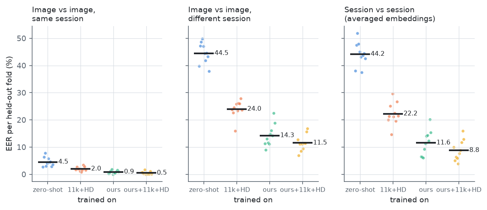
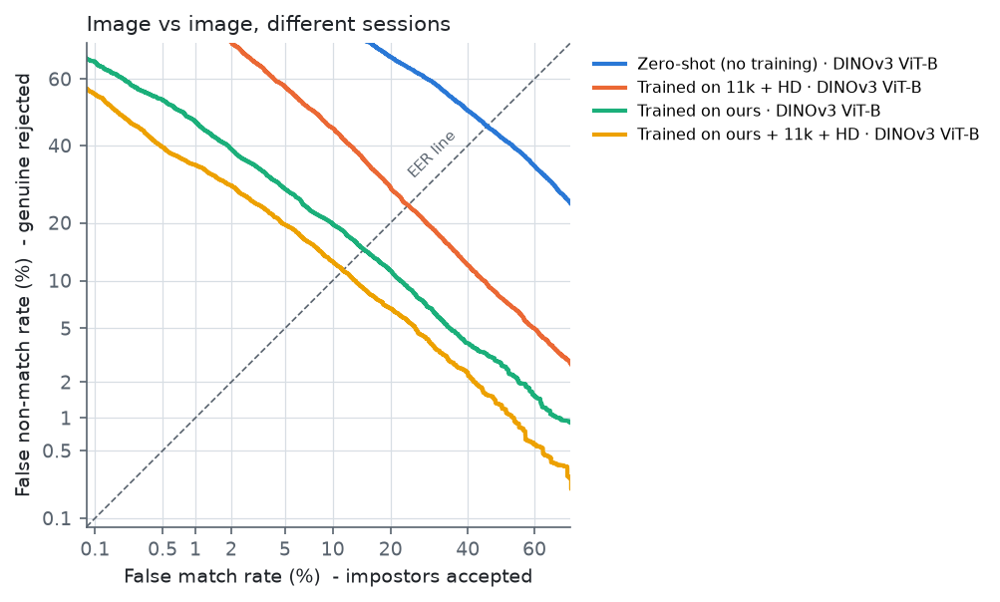
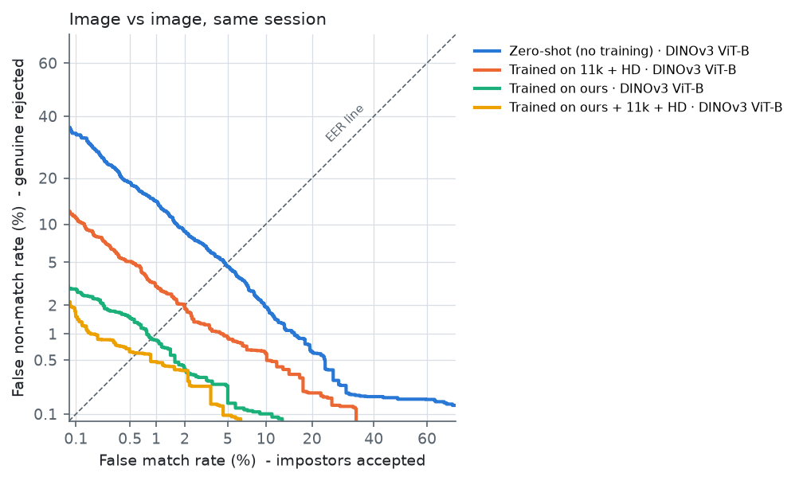
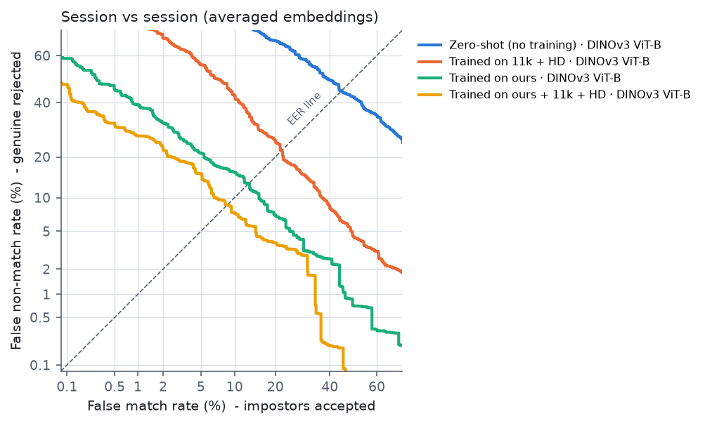

# Task 1 – Can our dataset be used to collect sessions for person identification?

**Question.** If a person records their hand in one session, can they be recognised
from a photo taken in another session? We measure this on people the model has
*never seen*: for each of the 10 people-disjoint folds of our dataset, the model is
trained without that fold and evaluated on it (10-fold cross-validation over people).

## What is compared

| Protocol | Genuine pair | Impostor pair |
|---|---|---|
| Image vs image, same session | two photos of the same hand from the same session | same side, different person |
| **Image vs image, cross-session** | two photos of the same hand from *different* sessions | same side, different person |
| **Session template** | average embedding of one session vs. another session of the same hand | same side, different person |
| Rank-1 (session) | gallery = first session of every hand in the fold (all hands, single-session ones act as distractors), probes = later sessions | – |

Every hand counts equally (pair weights), so the person with 79 sessions does not dominate.
Hands with only one session contribute impostor pairs only. Numbers are mean ± std over
the held-out folds; **EER** = equal error rate (lower is better), **TAR@FAR=1 %** =
share of genuine pairs accepted when 1 % of impostors are accepted (higher is better).
Rank-1 is measured within one fold (≈ 8–9 people, ≈ 15 hands), so it is an easy closed-set task.

## Results

| # | System | Folds | EER same session | **EER cross-session** | TAR@FAR=1 % cross-session | **EER session template** | TAR@FAR=1 % session template | Rank-1 (session) |
|---|---|---|---|---|---|---|---|---|
| 1 | Zero-shot (no training) · DINOv3 ViT-B | 10 | 4.5 ± 1.6 | 44.5 ± 3.7 | 11.0 ± 8.9 | 44.2 ± 4.2 | 15.5 ± 13.6 | 28.1 ± 10.7 |
| 2 | Trained on 11k + HD · DINOv3 ViT-B | 10 | 2.0 ± 0.8 | 24.0 ± 3.1 | 26.3 ± 11.1 | 22.2 ± 3.9 | 29.8 ± 12.6 | 57.0 ± 17.9 |
| 3 | Trained on ours · DINOv3 ViT-B | 10 | 0.9 ± 0.6 | 14.3 ± 3.8 | 54.7 ± 13.5 | 11.6 ± 4.4 | 64.3 ± 15.8 | 87.4 ± 7.1 |
| 4 | Trained on ours + 11k + HD · DINOv3 ViT-B | 10 | 0.5 ± 0.5 | 11.5 ± 2.9 | 65.8 ± 12.7 | 8.8 ± 3.6 | 74.1 ± 12.3 | 92.7 ± 4.7 |

DET curves (detection error trade-off: both error rates on a probit scale, lower-left is better,
a curve crosses the dashed diagonal at its EER). They pool the scores of all held-out folds,
each fold scored by the model that did not see it:

## Conclusion

**Yes - our dataset can be used to collect sessions for person identification, and its multi-session structure is exactly what makes it valuable.**

1. **Cross-session is the real problem.** Two photos from the same session are matched almost perfectly (EER 0.5 %), photos from different sessions are not (11.5 %). Same-session photos share background, light and pose; a system evaluated only within a session would look ~20x better than it is.
2. **Public data does not teach this.** 11k Hands and PolyU HD have one session per person. A model trained only on them reaches 24.0 % cross-session EER although it is excellent on their own test sets (1.8 % / 1.3 %).
3. **Training on our sessions halves the error:** 14.3 % with ours only, better than public-data-only in 10/10 folds (paired −9.7 ± 3.8 pp). Adding 11k + HD on top gives the best system, **11.5 % image-level and 8.8 % session-template EER**, better than ours-only in 9/10 folds (−2.7 ± 2.4 pp).
4. **Enrol with a session, not a photo.** Averaging the 4 photos of a session lowers the EER from 11.5 % to 8.8 % and raises TAR@FAR=1 % from 66 % to 74 %. Closed-set rank-1 within a fold is 93 %.
5. **What limits the dataset today:** only 53 of 87 people (105 of 168 hands) have a second session, sessions are very unevenly spread (one person has 79), and folds 8-9 are clearly harder (15-17 % EER). Collecting **more people with 3+ sessions on different days** is the most valuable next step; the label audit found 4 sessions stored under the wrong hand (fixed) and 67 duplicated photos (removed), so capture tooling should check hand side and duplicates at upload time.

Per-fold numbers

| System | Fold | EER cross-session | EER session template | Genuine cross-session pairs | Rank-1 |
|---|---|---|---|---|---|
| Zero-shot (no training) · DINOv3 ViT-B | fold_0 | 39.8 | 38.1 | 100928 | 15.7 |
| Zero-shot (no training) · DINOv3 ViT-B | fold_1 | 47.1 | 47.6 | 4304 | 31.4 |
| Zero-shot (no training) · DINOv3 ViT-B | fold_2 | 48.7 | 51.9 | 5680 | 49.0 |
| Zero-shot (no training) · DINOv3 ViT-B | fold_3 | 49.9 | 47.9 | 13856 | 22.4 |
| Zero-shot (no training) · DINOv3 ViT-B | fold_4 | 47.1 | 45.0 | 496 | 29.4 |
| Zero-shot (no training) · DINOv3 ViT-B | fold_5 | 44.4 | 43.2 | 1280 | 19.4 |
| Zero-shot (no training) · DINOv3 ViT-B | fold_6 | 41.9 | 37.5 | 9392 | 39.5 |
| Zero-shot (no training) · DINOv3 ViT-B | fold_7 | 44.6 | 43.7 | 2016 | 23.5 |
| Zero-shot (no training) · DINOv3 ViT-B | fold_8 | 43.4 | 44.4 | 12224 | 13.4 |
| Zero-shot (no training) · DINOv3 ViT-B | fold_9 | 37.9 | 42.5 | 6512 | 36.8 |
| Trained on 11k + HD · DINOv3 ViT-B | fold_0 | 23.9 | 20.0 | 100928 | 56.5 |
| Trained on 11k + HD · DINOv3 ViT-B | fold_1 | 22.6 | 21.4 | 4304 | 52.9 |
| Trained on 11k + HD · DINOv3 ViT-B | fold_2 | 24.6 | 25.2 | 5680 | 42.9 |
| Trained on 11k + HD · DINOv3 ViT-B | fold_3 | 15.9 | 14.7 | 13856 | 45.9 |
| Trained on 11k + HD · DINOv3 ViT-B | fold_4 | 25.8 | 29.7 | 496 | 94.1 |
| Trained on 11k + HD · DINOv3 ViT-B | fold_5 | 23.4 | 21.2 | 1280 | 69.4 |
| Trained on 11k + HD · DINOv3 ViT-B | fold_6 | 26.2 | 22.5 | 9392 | 75.0 |
| Trained on 11k + HD · DINOv3 ViT-B | fold_7 | 25.9 | 19.6 | 2016 | 38.2 |
| Trained on 11k + HD · DINOv3 ViT-B | fold_8 | 27.9 | 26.8 | 12224 | 32.1 |
| Trained on 11k + HD · DINOv3 ViT-B | fold_9 | 23.7 | 21.5 | 6512 | 63.2 |
| Trained on ours · DINOv3 ViT-B | fold_0 | 11.3 | 6.6 | 100928 | 95.4 |
| Trained on ours · DINOv3 ViT-B | fold_1 | 9.0 | 6.4 | 4304 | 84.3 |
| Trained on ours · DINOv3 ViT-B | fold_2 | 13.1 | 6.1 | 5680 | 87.8 |
| Trained on ours · DINOv3 ViT-B | fold_3 | 11.6 | 9.2 | 13856 | 71.4 |
| Trained on ours · DINOv3 ViT-B | fold_4 | 11.2 | 11.3 | 496 | 94.1 |
| Trained on ours · DINOv3 ViT-B | fold_5 | 14.8 | 14.1 | 1280 | 91.7 |
| Trained on ours · DINOv3 ViT-B | fold_6 | 16.1 | 14.3 | 9392 | 89.5 |
| Trained on ours · DINOv3 ViT-B | fold_7 | 14.2 | 12.4 | 2016 | 88.2 |
| Trained on ours · DINOv3 ViT-B | fold_8 | 22.5 | 20.1 | 12224 | 78.6 |
| Trained on ours · DINOv3 ViT-B | fold_9 | 18.9 | 15.3 | 6512 | 93.0 |
| Trained on ours + 11k + HD · DINOv3 ViT-B | fold_0 | 12.8 | 9.9 | 100928 | 98.6 |
| Trained on ours + 11k + HD · DINOv3 ViT-B | fold_1 | 6.9 | 5.1 | 4304 | 88.2 |
| Trained on ours + 11k + HD · DINOv3 ViT-B | fold_2 | 11.2 | 6.4 | 5680 | 83.7 |
| Trained on ours + 11k + HD · DINOv3 ViT-B | fold_3 | 8.5 | 6.0 | 13856 | 86.7 |
| Trained on ours + 11k + HD · DINOv3 ViT-B | fold_4 | 11.1 | 3.8 | 496 | 94.1 |
| Trained on ours + 11k + HD · DINOv3 ViT-B | fold_5 | 9.4 | 7.6 | 1280 | 97.2 |
| Trained on ours + 11k + HD · DINOv3 ViT-B | fold_6 | 11.4 | 8.9 | 9392 | 97.4 |
| Trained on ours + 11k + HD · DINOv3 ViT-B | fold_7 | 11.5 | 11.7 | 2016 | 94.1 |
| Trained on ours + 11k + HD · DINOv3 ViT-B | fold_8 | 15.7 | 15.9 | 12224 | 93.8 |
| Trained on ours + 11k + HD · DINOv3 ViT-B | fold_9 | 16.8 | 12.9 | 6512 | 93.0 |

## Runs

Every number above comes from these MLflow runs (experiment: [https://mlflow.capturemyhand.com/#/experiments/8](https://mlflow.capturemyhand.com/#/experiments/8)).

| System | Run | MLflow | Commit |
|---|---|---|---|
| Zero-shot (no training) · DINOv3 ViT-B | one run, all folds | [zero_shot-dinov3_vitb-fold0](https://mlflow.capturemyhand.com/#/experiments/8/runs/c1080ee966934132b0ed95801e37ca33) | `f49266f` |
| Trained on 11k + HD · DINOv3 ViT-B | one run, all folds | [external_only-dinov3_vitb-fold0](https://mlflow.capturemyhand.com/#/experiments/8/runs/270a4b4b2a404284922a8b46c6a008ef) | `f49266f` |
| Trained on ours · DINOv3 ViT-B | fold 0 | [ours_only-dinov3_vitb-fold0](https://mlflow.capturemyhand.com/#/experiments/8/runs/49e3afcbb2fd45159ea165e692e31a55) | `b4543df` |
| Trained on ours · DINOv3 ViT-B | fold 1 | [ours_only-dinov3_vitb-fold1](https://mlflow.capturemyhand.com/#/experiments/8/runs/c8a1d1f3b34d441abfa8833f81b5aef9) | `b4543df` |
| Trained on ours · DINOv3 ViT-B | fold 2 | [ours_only-dinov3_vitb-fold2](https://mlflow.capturemyhand.com/#/experiments/8/runs/76be974661de4d3b9c94b19d85e19d40) | `b4543df` |
| Trained on ours · DINOv3 ViT-B | fold 3 | [ours_only-dinov3_vitb-fold3](https://mlflow.capturemyhand.com/#/experiments/8/runs/e6790a67662140faa3ade54328b1e7c5) | `b4543df` |
| Trained on ours · DINOv3 ViT-B | fold 4 | [ours_only-dinov3_vitb-fold4](https://mlflow.capturemyhand.com/#/experiments/8/runs/ad61076e9f64411d9d0f7e98690ea771) | `b4543df` |
| Trained on ours · DINOv3 ViT-B | fold 5 | [ours_only-dinov3_vitb-fold5](https://mlflow.capturemyhand.com/#/experiments/8/runs/5be2c4e1b46149cb9c9341b13b858f07) | `b4543df` |
| Trained on ours · DINOv3 ViT-B | fold 6 | [ours_only-dinov3_vitb-fold6](https://mlflow.capturemyhand.com/#/experiments/8/runs/69cb6ebb89614a7a80e3e8a70cd08d24) | `b4543df` |
| Trained on ours · DINOv3 ViT-B | fold 7 | [ours_only-dinov3_vitb-fold7](https://mlflow.capturemyhand.com/#/experiments/8/runs/642cb1cdf4b047acab950e1471006d51) | `b4543df` |
| Trained on ours · DINOv3 ViT-B | fold 8 | [ours_only-dinov3_vitb-fold8](https://mlflow.capturemyhand.com/#/experiments/8/runs/93a69c7aa29c490ba51b5e3480c48735) | `b4543df` |
| Trained on ours · DINOv3 ViT-B | fold 9 | [ours_only-dinov3_vitb-fold9](https://mlflow.capturemyhand.com/#/experiments/8/runs/6c372d70108f447cb5067699efa49957) | `b4543df` |
| Trained on ours + 11k + HD · DINOv3 ViT-B | fold 0 | [ours_external-dinov3_vitb-fold0](https://mlflow.capturemyhand.com/#/experiments/8/runs/69fbeb1f6e09484d8790ee25810517eb) | `b4543df` |
| Trained on ours + 11k + HD · DINOv3 ViT-B | fold 1 | [ours_external-dinov3_vitb-fold1](https://mlflow.capturemyhand.com/#/experiments/8/runs/87f7778d3a5c481fa387f13cd6e25d14) | `b4543df` |
| Trained on ours + 11k + HD · DINOv3 ViT-B | fold 2 | [ours_external-dinov3_vitb-fold2](https://mlflow.capturemyhand.com/#/experiments/8/runs/ca072327d10c4e07b3081c90eeb91f12) | `b4543df` |
| Trained on ours + 11k + HD · DINOv3 ViT-B | fold 3 | [ours_external-dinov3_vitb-fold3](https://mlflow.capturemyhand.com/#/experiments/8/runs/1925a7b44598425a9fbc59c76fa32f45) | `b4543df` |
| Trained on ours + 11k + HD · DINOv3 ViT-B | fold 4 | [ours_external-dinov3_vitb-fold4](https://mlflow.capturemyhand.com/#/experiments/8/runs/558f955ff9ed4398892ec17297b80f71) | `b4543df` |
| Trained on ours + 11k + HD · DINOv3 ViT-B | fold 5 | [ours_external-dinov3_vitb-fold5](https://mlflow.capturemyhand.com/#/experiments/8/runs/8d83b3642fd54e908d49597e23056acb) | `b4543df` |
| Trained on ours + 11k + HD · DINOv3 ViT-B | fold 6 | [ours_external-dinov3_vitb-fold6](https://mlflow.capturemyhand.com/#/experiments/8/runs/6c962a51a0aa494f889f256e1b7ae17d) | `b4543df` |
| Trained on ours + 11k + HD · DINOv3 ViT-B | fold 7 | [ours_external-dinov3_vitb-fold7](https://mlflow.capturemyhand.com/#/experiments/8/runs/d7d1cb30c6a24af7a9d921fc526873a4) | `b4543df` |
| Trained on ours + 11k + HD · DINOv3 ViT-B | fold 8 | [ours_external-dinov3_vitb-fold8](https://mlflow.capturemyhand.com/#/experiments/8/runs/bd6bfb3ce6d9438eb127a865202846f0) | `b4543df` |
| Trained on ours + 11k + HD · DINOv3 ViT-B | fold 9 | [ours_external-dinov3_vitb-fold9](https://mlflow.capturemyhand.com/#/experiments/8/runs/1ab6e415e4ff486daba779e11218d84a) | `b4543df` |
